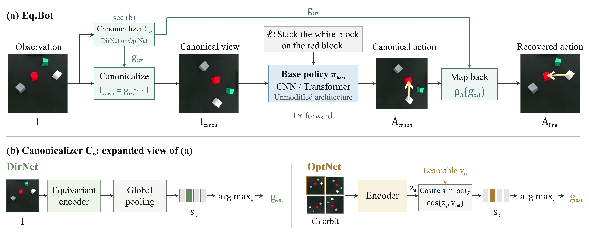

# Eq.Bot: Model-Agnostic Canonicalization for Equivariant Robotic Manipulation

This package provides the core implementation of **Eq.Bot**, a model-agnostic framework for geometrically consistent robotic manipulation. Eq.Bot uses a shared learned frame for observation canonicalization and representation-specific action recovery, preserving the architecture and native action interface of existing CNN- and Transformer-based policies.

## Overview

Vision-language-action (VLA) policies can generalize to new objects and instructions, while remaining sensitive to scene rotations. Maintaining geometric consistency across existing policies is further complicated by their different action representations, from pixel affordances to Cartesian actions and joint targets.

**Eq.Bot** is a model-agnostic canonicalization framework for robotic manipulation grounded in group equivariance. It aligns the observation to a learned canonical frame, evaluates the base policy once with the original language instruction, and reuses the same frame estimate to recover the action in the original coordinates. The recovery map is tailored to the native action representation, so the base policy retains both its architecture and its output interface. The composite policy is equivariant when frame estimates are consistent with scene transformations and the observation and action mappings are compatible.



### Canonicalizers

Eq.Bot provides two ways to learn a canonical frame within the same interface:

- **DirNet** scores candidate frames directly from group-equivariant features.
- **OptNet** encodes transformed views with a conventional CNN or Wide ResNet-50 and scores them against a learned reference by cosine similarity.

Both variants can be trained jointly with the trainable components of the base policy under task supervision. The base policy processes only the selected view, regardless of how many candidates the canonicalizer scores.

## Code Organization

| Module | Contents |
| --- | --- |
| `common/basecanonicalization.py` | Shared base classes for identity, discrete, and continuous canonicalization. |
| `common/action_canonicalization.py` | Rigid frames and representation-specific action maps. |
| `common/utils.py` | Shared tensor geometry, image warps, and annotation transforms. |
| `canonicalization/` | Discrete image and VLA wrappers and continuous planar canonicalizers. |
| `canonicalization_networks/` | Discrete DirNet, its continuous steerable counterpart, and conventional CNN and Wide ResNet-50 encoders for OptNet. |

Use `eqbot.common` to import the action interface. The discrete image wrappers expose `GroupEquivariantImageCanonicalization` for DirNet and `OptimizedGroupEquivariantImageCanonicalization` for OptNet. The continuous variants are defined in `canonicalization/continuous_group.py`.

## Quick Start

Use Python 3.10 or later with PyTorch for the action interface. The image wrappers also require NumPy, Kornia, TorchVision, and OmegaConf. The discrete DirNet encoder requires `e2cnn`, and the continuous steerable encoder requires `escnn`. The Wide ResNet-50 encoder defaults to `weights=None`, so initialization does not download weights.

Run the example from the directory containing `eqbot/`. It uses a known frame and a synthetic Cartesian action to check action recovery on CPU, with no simulator, checkpoint, or robot required. `ActionFrame` maps canonical coordinates to original coordinates; `canonicalize` maps training targets into the canonical frame, and `decanonicalize` maps predictions back.

```bash
import torch
from eqbot.common import ActionCanonicalizer, ActionFrame

frame = ActionFrame.from_yaw(torch.tensor([torch.pi / 2]),
                             torch.tensor([0.4, 0.0, 0.0]))
actions = torch.tensor([[[0.5, 0.0, 0.2, 0.0, 0.0, 0.0, 1.0]]])
mapper = ActionCanonicalizer("absolute_rotvec")
targets = mapper.canonicalize(actions, frame)
recovered = mapper.decanonicalize(targets, frame)
torch.testing.assert_close(recovered, actions)
print("Action recovery round trip passed.")
```

## Policy Integrations and Evaluation

The paper evaluates Eq.Bot across four simulation benchmarks and three UR5e tasks: Place Object, Pack Box, and Stack Blocks. The integrations use the same frame convention while retaining the native policy outputs listed below.

| Policy and setting | Representation | Recovery |
| --- | --- | --- |
| CLIPORT on Ravens | `pixel_pick_place` or `spatial_maps` | Recover pixel locations, absolute headings, or spatial score maps. Relative place headings are unchanged. |
| OpenVLA-OFT on LIBERO | `delta_rotvec` | Rotate workspace-frame translation and rotation increments without adding a position offset. |
| OpenVLA-OFT on the physical robot | `absolute_rotvec` | Compose the absolute end-effector pose with the estimated frame. |
| $\pi_{0.5}$ on VLABench | `absolute_euler_xyz` | Compose the pose and re-encode its orientation as extrinsic XYZ Euler angles. |
| TurboVLA on RoboTwin 2.0 | `bimanual_joint` | Transform each arm's pose through forward and inverse kinematics on a fixed reachable branch. |

## Performance Benchmarks

| Setting | Base policy | Metric (%) | Base | + OptNet | + DirNet |
| --- | --- | --- | ---: | ---: | ---: |
| Ravens | CLIPORT | Mean completion (100 demonstrations per task) | 66.97 | 76.06 | **76.75** |
| LIBERO | OpenVLA-OFT | Mean success | 96.5 | 97.5 | **97.7** |
| VLABench | $\pi_{0.5}$ | Mean intention score | 61.0 | 66.4 | **67.1** |
| VLABench | $\pi_{0.5}$ | Mean progress score | 42.4 | 45.5 | **46.1** |
| RoboTwin 2.0 | TurboVLA | Mean success (Clean and Randomized) | 87.55 | 89.88 | **90.96** |
| UR5e | OpenVLA-OFT | Mean collision-free success | 63.3 | 76.7 | **83.3** |
| UR5e | OpenVLA-OFT | Mean progress score | 78.7 | 92.7 | **93.2** |

OptNet denotes the ResNet-50 variant in this comparison. The Ravens row averages 18 task settings at the indicated demonstration budget. See the paper and appendix for the full comparisons, including OptNet-CNN and the per-task results.

### Integration Notes

Decode normalized outputs before applying the recovery map. For physical actions, use float32 or float64, with positions in meters and angles in radians. Recovery preserves gripper commands. For square image outputs, `ActionFrame.from_image_rotation` builds a pixel-space frame from the stored angle. Pixel actions use column/row order; account for padding when converting between image and canvas coordinates.

For multiview control, use a consistent workspace frame across views, proprioception, and action recovery. The dual-camera wrapper does not infer this frame from independently estimated image angles. For joint recovery, supply `forward`, `inverse`, and `in_domain` for each arm in the same workspace coordinates.

## Code Release

This supplementary package contains the shared Eq.Bot implementation. The experiment-specific code and data needed to reproduce the results are being prepared for public release:

- **Simulation:** Policy integrations and training and evaluation scripts for Ravens, LIBERO, VLABench, and RoboTwin 2.0, along with instructions for obtaining and preparing the public benchmark datasets.
- **Real world:** UR5e training, deployment, and evaluation code, along with the collected robot demonstration dataset.

Datasets, trained checkpoints, camera calibrations, and robot-specific kinematics are outside the scope of this supplementary package.


